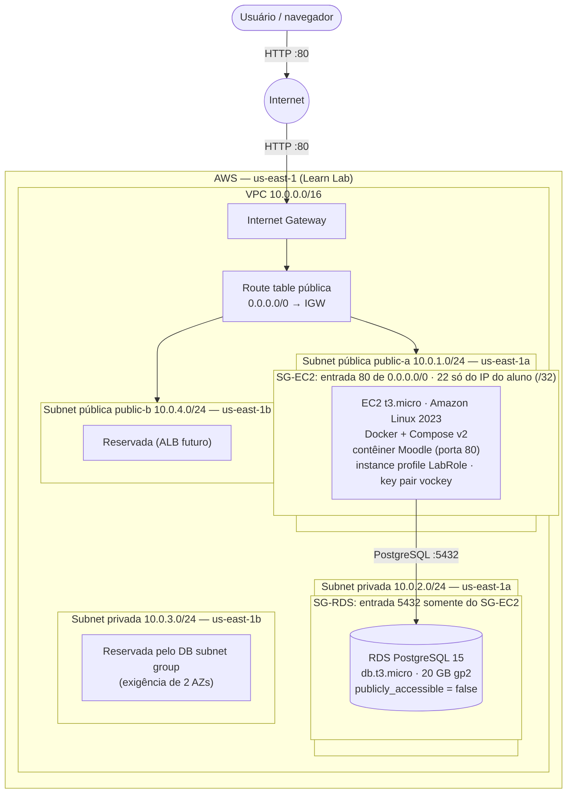

# Design de Arquitetura — Moodle Docker AWS Challenge

> **Status:** versão final da P2. As seções descrevem a arquitetura implementada nos módulos Terraform em `terraform/`
> (`terraform fmt -check` e `terraform validate` sem erros).

---

## Visão Geral

A solução coloca o Moodle 4.1 em produção na AWS usando o mesmo contêiner validado localmente com `docker compose`. Uma instância EC2 `t3.micro` (Amazon Linux 2023) em subnet pública executa o Moodle em Docker; o banco de dados é um RDS PostgreSQL 15 (`db.t3.micro`) em subnet privada, sem IP público.

Toda a infraestrutura é provisionada com Terraform na região `us-east-1` do AWS Learn Lab, dividida em três módulos: `networking` (VPC, subnets, IGW, route table, security groups), `compute` (EC2 + `user_data.sh`) e `database` (RDS + subnet group). No boot, o `user_data.sh` instala Docker e Git via `dnf`, baixa o plugin Docker Compose v2 (binário oficial com versão fixa), clona o fork do repositório e sobe somente o serviço `moodle` (`docker compose up -d --no-deps moodle`), apontando para o endpoint do RDS.

As decisões de alto nível foram guiadas pelas restrições do Learn Lab: nenhum recurso IAM é criado (a EC2 usa o `LabRole` via data source), não há Route 53, ACM nem CloudFront (acesso por HTTP na porta 80 pelo DNS público da EC2) e as credenciais são temporárias (~4 h), o que exige estado e segredos fora do repositório.

## Diagrama de Arquitetura

O diagrama abaixo (Mermaid, renderizado pelo GitHub) mostra os recursos criados pelo Terraform e o fluxo de tráfego **Internet → IGW → EC2 → RDS**.

| Fluxo | Origem → destino | Porta | Controle |
|---|---|---|---|
| Acesso ao Moodle | Internet → IGW → EC2 | TCP 80 | SG-EC2 libera 80 de `0.0.0.0/0` |
| Administração | IP do aluno → EC2 | TCP 22 | SG-EC2 libera 22 só de `var.ssh_allowed_cidr` (obrigatório, `/32`) |
| Banco de dados | EC2 → RDS | TCP 5432 | SG-RDS aceita apenas o SG-EC2 como origem |
| Saída da EC2 | EC2 → Internet (dnf, GitHub, Docker Hub) | todas | Egress liberado no SG-EC2 |

## Decisões de Design

| Componente | Escolha | Justificativa |
|---|---|---|
| Tipo de instância EC2 | `t3.micro` | Exigido pela prova; menor custo (US$ 7,59/mês). Impacto: 1 vCPU e 1 GB de RAM — o `user_data` faz o build da imagem na EC2, então o boot fica mais lento e há risco de falta de memória no build; o Moodle responde mais devagar sob carga. Aceitável para avaliação; em produção usar `t3.medium` ou imagem pré-construída. |
| Engine do banco de dados | RDS PostgreSQL 15 | Mesma versão do ambiente local (`postgres:15`), o que evita diferenças de comportamento entre local e nuvem; serviço gerenciado tira backup e patch do escopo da EC2. |
| Classe da instância RDS | `db.t3.micro` | Menor classe suportada; suficiente para carga de estudo e economiza o crédito do Lab. |
| AMI da EC2 | Amazon Linux 2023 | AMI mantida pela AWS, com Docker disponível via `dnf`; buscada por data source para sempre pegar a versão mais recente. |
| Topologia de rede | 2 subnets públicas + 2 privadas em AZs distintas | EC2 em public-a (us-east-1a); public-b (us-east-1b) reservada para ALB futuro; RDS isolado em subnets privadas; `aws_db_subnet_group` exige subnets em pelo menos 2 AZs. |
| Acesso IAM na EC2 | LabRole via data source | O Learn Lab bloqueia criação de roles/instance profiles; `data "aws_iam_instance_profile"` referencia o perfil existente. |
| Segredos | Variáveis `sensitive = true` + `terraform.tfvars` fora do Git | Nenhuma senha no código; mesmo padrão já aplicado no `docker/.env` local. |

## Componentes

### VPC

`10.0.0.0/16` em `us-east-1`, com `enable_dns_hostnames = true` e `enable_dns_support = true` (necessário para o DNS público da EC2 e para resolver o endpoint do RDS).

### Subnets

| Nome | Tipo | CIDR | AZ | Hospeda |
|---|---|---|---|---|
| public-a | Pública (`map_public_ip_on_launch = true`) | `10.0.1.0/24` | us-east-1a | EC2 Moodle |
| public-b | Pública (`map_public_ip_on_launch = true`) | `10.0.4.0/24` | us-east-1b | Reservada (ALB futuro) |
| private-a | Privada | `10.0.2.0/24` | us-east-1a | RDS PostgreSQL |
| private-b | Privada | `10.0.3.0/24` | us-east-1b | Apenas subnet group do RDS |

### Internet Gateway e Route Table

Um Internet Gateway associado à VPC e uma route table pública com a rota `0.0.0.0/0 → IGW`, associada às duas subnets públicas (public-a e public-b). As subnets privadas usam a route table principal (sem saída para a internet).

### Security Group — EC2

- Ingresso TCP 80 de `0.0.0.0/0` (acesso ao Moodle).
- Ingresso TCP 22 apenas de `var.ssh_allowed_cidr`. A variável é **obrigatória, sem default**, com `validation` que exige formato `/32` e rejeita `0.0.0.0/0`; preencher no `terraform.tfvars` com o IP do aluno (descubra com `curl https://checkip.amazonaws.com`).
- Egresso liberado (download de pacotes, imagens Docker e Moodle).

### Security Group — RDS

- Ingresso TCP 5432 **somente** com origem no SG da EC2 (`security_groups = [aws_security_group.ec2.id]`), nunca por CIDR.
- Sem regras adicionais de ingresso.

### Instância EC2

`t3.micro`, AMI Amazon Linux 2023 (data source), na subnet pública public-a, key pair `vockey` do Lab, instance profile `LabRole`. Disco raiz de 20 GB gp3 (`root_block_device`): o disco padrão da AMI (2 GB) esgotou durante o build da imagem Docker no primeiro deploy (`no space left on device`). O `user_data.sh` (renderizado com `templatefile()`) instala Docker e Git, baixa o plugin Compose v2 com versão fixa, clona o fork (`repo_url`/`repo_branch`), gera `docker/.env` com permissão `600` a partir das variáveis do Terraform (host e porta do RDS, usuário, senhas e `MOODLE_HTTP_PORT=80`) e executa `docker compose up -d --no-deps moodle`, já que o banco é o RDS e não o contêiner `db`. O log fica em `/var/log/user-data.log`.

### RDS PostgreSQL

Engine `postgres` 15, classe `db.t3.micro`, 20 GB `gp2`, `multi_az = false`, `publicly_accessible = false`, `skip_final_snapshot = true` (ambiente de estudo), subnet group com `private-a` e `private-b`. Senha via variável sensível.

## Segurança

- **Isolamento de rede:** RDS em subnet privada, sem IP público e sem rota para a internet.
- **Menor privilégio:** SG do RDS aceita 5432 apenas do SG da EC2; SSH limitado ao `/32` do aluno via `var.ssh_allowed_cidr` (obrigatório, sem default, com `validation` que rejeita `0.0.0.0/0` e exige `/32`).
- **Credenciais:** senhas em variáveis `sensitive = true`, sem valor padrão e com `validation` (somente letras e números, mínimo 12 caracteres, o que evita problemas de escape no `.env`); valores em `terraform.tfvars` (ignorado pelo `.gitignore`). No ambiente local, o `docker-compose.yml` lê `docker/.env` (fora do Git).
- **Limitação conhecida:** as senhas passadas ao `user_data` ficam no `terraform.tfstate` e no atributo user data da instância. O state nunca vai para o Git; a evolução prevista é buscar as senhas no SSM Parameter Store ou no Secrets Manager.
- **Credenciais AWS:** temporárias do Learn Lab, apenas em `~/.aws/credentials` local e nos secrets do GitHub (`AWS_ACCESS_KEY_ID`, `AWS_SECRET_ACCESS_KEY`, `AWS_SESSION_TOKEN`, além dos `TF_VAR_*` usados pelo `terraform-plan.yml`), nunca no repositório.
- **IAM:** uso exclusivo do `LabRole` via data source; nenhum `aws_iam_*` declarado como recurso.
- **Estado:** `terraform.tfstate` fora do Git (backend S3 avaliado para as próximas aulas).

## Escalabilidade

**Limitações atuais (Learn Lab):** uma única EC2 em uma AZ (ponto único de falha), RDS `db.t3.micro` single-AZ, sem HTTPS e sem Auto Scaling.

**Em produção real:**
- Application Load Balancer + Auto Scaling Group com Launch Template em 2+ AZs (as estratégias Blue/Green e Canary da aula 11 passam a ser possíveis sobre o ALB).
- `moodledata` compartilhado em EFS, já que várias instâncias precisam do mesmo diretório.
- RDS Multi-AZ e réplicas de leitura; cache de sessão em ElastiCache (Redis).
- HTTPS com ACM no ALB e CloudFront para estáticos.

**Mudanças no Terraform:** trocar `aws_instance` por `aws_launch_template` + `aws_autoscaling_group`, adicionar módulo `loadbalancer` (`aws_lb`, `aws_lb_target_group`, `aws_lb_listener`), `multi_az = true` no RDS e um módulo `storage` com `aws_efs_file_system`.

## Custo Estimado

Valores de referência On-Demand em `us-east-1`, 730 h/mês, conferidos no AWS Pricing Calculator (link abaixo).

| Serviço | Tipo/Configuração | Custo estimado (USD/mês) |
|---|---|---|
| EC2 | `t3.micro`, On-Demand, 730h (US$ 0,0104/h) | 7,59 |
| RDS PostgreSQL | `db.t3.micro`, 20 GB SSD, 730h (US$ 0,018/h + 20 × US$ 0,115) | 15,44 |
| Armazenamento EBS (EC2) | 20 GB gp3, disco raiz ampliado para suportar o build Docker (US$ 0,08/GB) | 1,60 |
| Transferência de dados | 10 GB saída (dentro dos 100 GB/mês gratuitos) | 0,00 |
| IPv4 público | 1 IP, 730h (US$ 0,005/h) | 3,65 |
| **Total estimado** | | **≈ 28,28** |

> Estimativa compartilhável no AWS Pricing Calculator: [EC2 t3.micro + EBS 20 GB gp3 + RDS PostgreSQL db.t3.micro, us-east-1](https://calculator.aws/#/estimate?id=df355039d9648d2a6b1ccd00aa59804f0e143d95)
> A calculadora mostra US$ 24,63/mês; o IPv4 público (US$ 3,65) foi somado à parte.
>
> No Learn Lab o custo é coberto pelo crédito do curso; ao fim de cada sessão, `terraform destroy` evita consumo desnecessário.
